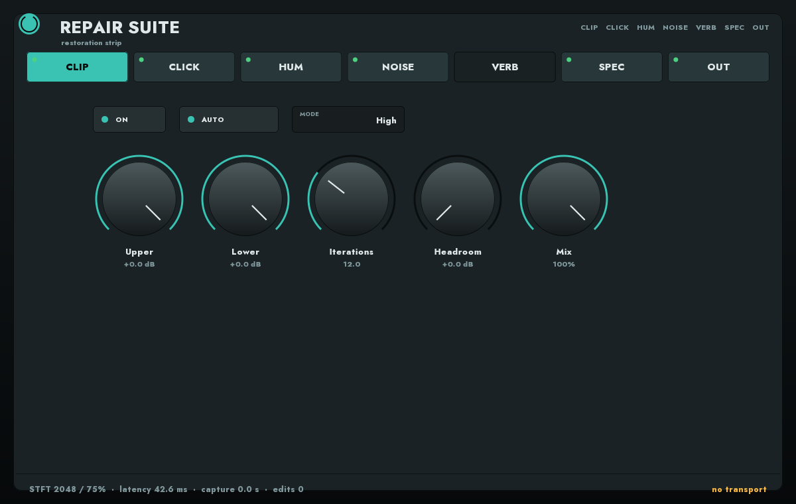

# Repair Suite

**Status: Phase 0 scaffold.** The plug-in builds and loads as CLAP and LV2, the
shared STFT and spectral capture/overlay prototype are tested, and the panel
skeleton draws seven pages. The repair DSP modules are not implemented yet.

Repair Suite is a real-time audio repair strip for Linux: de-clip, de-click,
de-hum, de-noise, de-reverb and selection-based spectral repair, in one fixed
chain with per-stage bypass. Planned as the restoration counterpart to Comp
Suite, Vocal Suite and Space Suite.



## What works today

- CLAP and LV2 bundles build and load in host smoke tests.
- 48 host parameters covering the planned modules.
- 1200×760 Cairo/Jost panel with seven pages: CLIP, CLICK, HUM, NOISE, VERB,
  SPEC, OUT. Controls are wired to parameters.
- **De-Clip** is the first real DSP module: flat-top detection, cubic, balanced
  and clipping-consistent iterative STFT reconstruction, auto/manual
  thresholds, mix and output headroom.
- Shared real-time STFT: 2048-sample frames, 75% overlap, identity
  reconstruction is unit-tested.
- Total reported latency is 3582 samples (~74.6 ms at 48 kHz): 1535 for
  De-Clip plus 2047 for the shared STFT.
- Spectral capture prototype: rolling buffer with host-time stamps,
  timeline-anchored edit overlays and crossfades. Unit-tested; not yet wired to
  a spectral editor UI.
- All host, panel, DSP and UI smoke tests pass.

## Not implemented yet

- De-Click, De-Hum, De-Noise and De-Reverb DSP.
- The spectral editor (capture/select/interpolate UI) and state serialisation.
- Preset browser UI (the preset table and LV2 preset export already exist).
- Loudness/latency status polish.

## Build

Requires CMake 3.16+, a C++17 compiler, Cairo, FreeType, X11, LV2 and lilv
development packages.

```sh
git submodule update --init --recursive   # if third_party is a submodule
cmake -S . -B build -DCMAKE_BUILD_TYPE=Release \
  -DLV2_DIR="$HOME/.lv2" -DCLAP_DIR="$HOME/.clap"
cmake --build build -j
ctest --test-dir build --output-on-failure
cmake --install build
```

The plug-in installs as:

- `~/.clap/RepairSuite.clap` + `RepairSuite.resources/`
- `~/.lv2/repair-suite.lv2/`

## Design and roadmap

The full research, chain order, DSP design, UI plan and phased roadmap live in
[`docs/RESEARCH_AND_PLAN.md`](docs/RESEARCH_AND_PLAN.md).

Licence: GPL-3.0-or-later.
