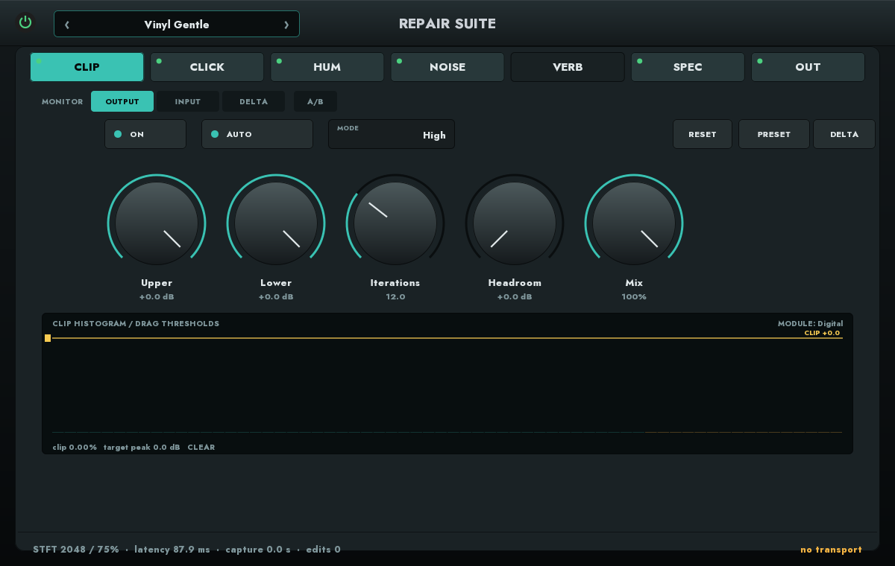
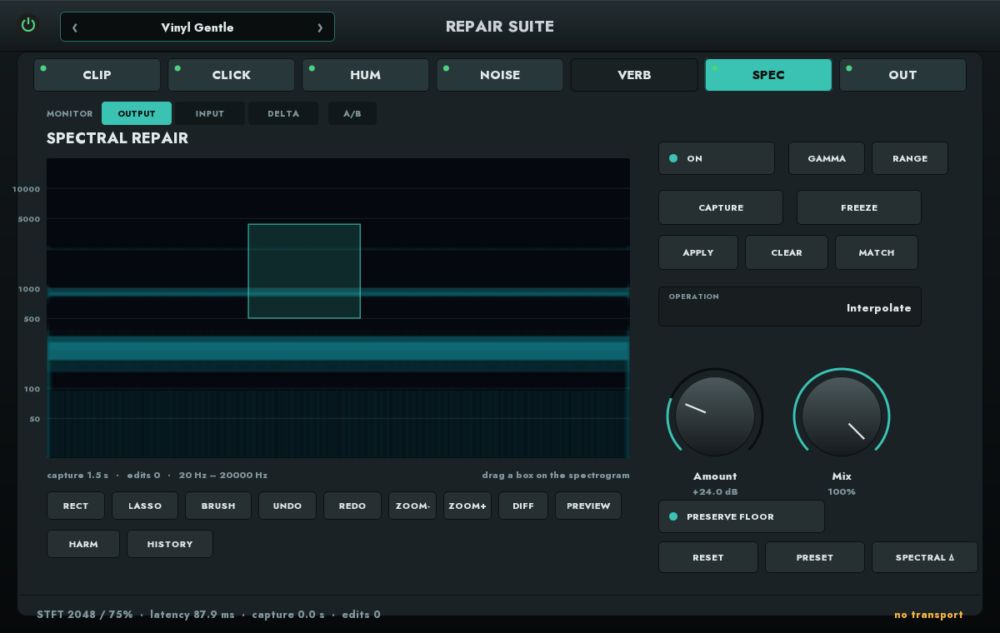
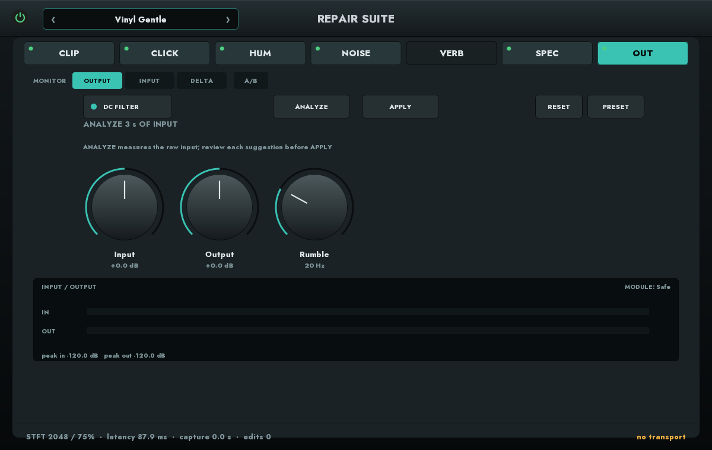
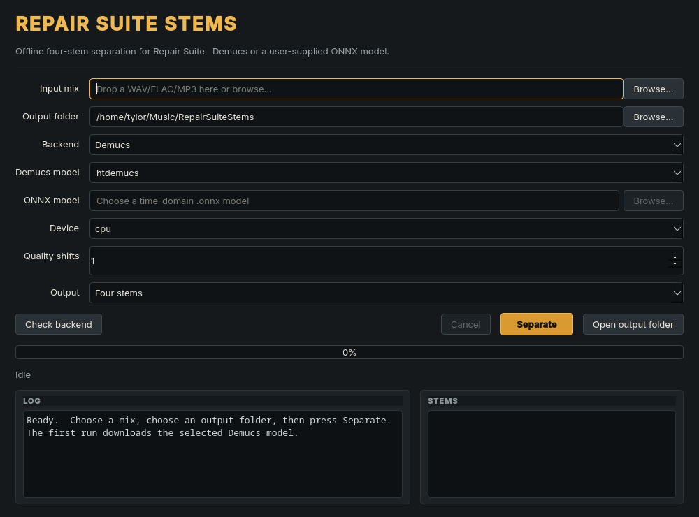

# Repair Suite

**Status: release-candidate alpha.** One CLAP + LV2 plug-in with the automatic
repair chain, Auto Analyze, a preset browser and an in-window spectral editor.
Manual tuning on real material is the remaining release work.

Repair Suite is a real-time audio repair strip for Linux, in the same visual
language as Comp Suite, Vocal Suite and Space Suite.









## Signal chain

```
Input → De-Clip → De-Click → De-Hum → De-Noise → De-Reverb
      → Spectral Repair → Output
```

All stages are always instantiated. Per-stage ON and MIX keep latency constant.
Each page also has a live stage monitor: clip envelope/threshold, click events,
hum harmonic series, noise reduction history, reverb-tail history, and
input/output levels.
Total latency is **4221 samples** (~87.9 ms at 48 kHz): 1535 for De-Clip, 639
for De-Click and 2047 for the shared STFT. Hum, noise and reverb add no extra
latency.

## Automatic modules

- **De-Clip** — flat-top detection, Fast/Balanced/High reconstruction, iterative
  clipping-consistent STFT mode, automatic thresholds, mix and headroom.
- **De-Click** — click, crackle, thump and dropout detection modes,
  stereo-linked repair, sensitivity, width and mix.
- **De-Hum** — notch bank and adaptive sinusoidal precision mode, automatic
  50/60 Hz harmonic detection, odd-only, depth and mix.
- **De-Noise** — two-second learned profile or adaptive bootstrap, spectral
  subtraction, transient hold, smoothing, reduction and mix. The profile is
  saved in session state.
- **De-Reverb** — late-tail spectral subtraction with tail length, pre-delay,
  transient protection, tilt and mix, sharing the denoise STFT.

## Auto Analyze

The OUT page has ANALYZE and APPLY. Analyze measures three seconds of raw input
— hum frequency/level, noise floor, clipping, click density and a rough reverb
tail — and APPLY sets conservative starts for the modules that are clearly
needed.

## Presets

The header has a preset browser with 28 factory presets across Vinyl,
Dialogue, Podcast, Drums, Bass, Guitars, Mix Bus, Space, Archive, Stems and
Utility, with dirty-state indication, scrolling and previous/next navigation.
Presets are also exported as LV2 preset banks.

## Spectral editor

- Rolling capture, stable freeze snapshot, full spectrogram with log frequency
  axis.
- Rectangle, lasso and brush selection.
- Time zoom (wheel or buttons) and right-drag panning.
- Attenuate, Erase, Interpolate, Patch, basic Match and Amplify.
- Undo/redo, edit list, per-edit host-time anchoring and playback overlay.
- Preview loop of the selected/edited audio.
- Original-vs-processed difference spectrogram.
- Spectral edits are saved in CLAP and LV2 session state.

LV2 spectral capture depends on the host providing `instance-access`; when it
is absent the page says so. CLAP always has direct access.

## Build

Requires CMake 3.16+, a C++17 compiler, Cairo, FreeType, X11, LV2 and lilv
development packages.

```sh
git submodule update --init --recursive   # if third_party is a submodule
cmake -S . -B build -DCMAKE_BUILD_TYPE=Release \
  -DLV2_DIR="$HOME/.lv2" -DCLAP_DIR="$HOME/.clap"
cmake --build build -j
ctest --test-dir build --output-on-failure
cmake --install build
```

Installs to:

- `~/.clap/RepairSuite.clap` + `RepairSuite.resources/`
- `~/.lv2/repair-suite.lv2/`

## Offline ML source separation

The real-time plug-in deliberately does not embed a Demucs-class model.  The
standalone **Repair Suite Stems** app and the `repair-separate` CLI separate a
mix offline into vocals, drums, bass and other stems, using Demucs or a
user-supplied time-domain ONNX model.  Bring the stems back into the DAW for
repair or remixing.

```sh
repair-stems          # standalone PySide6 GUI
```

```sh
python3 -m venv ~/.local/share/repair-suite/venv
~/.local/share/repair-suite/venv/bin/pip install demucs numpy
repair-separate song.wav ~/stems
repair-separate interview.wav ~/stems --two-stems vocals
```

See [`docs/SEPARATION.md`](docs/SEPARATION.md) for ONNX, model order, licensing
and workflow.

## Still to do

- Real-world listening/tuning pass on vinyl, dialogue, drums and clipped
  material.
- Even deeper Match/ML (the current version uses a 2D spectral-template
  similarity search and repeats the last repair).
- ARA/standalone spectral editing, if the Linux host ecosystem makes it useful.

Full research, design and roadmap: [`docs/RESEARCH_AND_PLAN.md`](docs/RESEARCH_AND_PLAN.md).

Licence: GPL-3.0-or-later.
